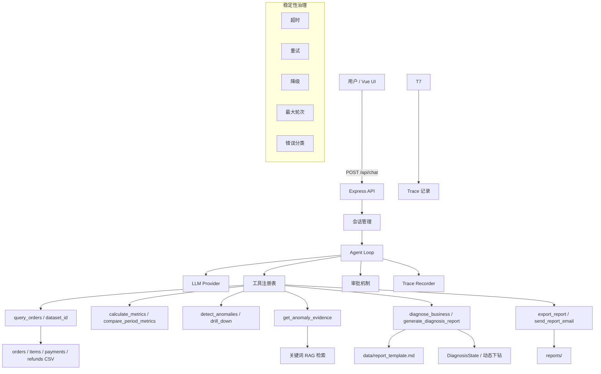

# business-agent-mvp

> 多工具经营异常诊断 Agent

项目以订单、支付和退款事件为业务场景，提供分期指标、异常诊断、下钻证据、报告交付和审批模拟。

## 启动项目

完整运行说明见 [docs/RUNNING.md](docs/RUNNING.md)。本地开发使用两个终端：

```powershell
# 终端 1：安装依赖并启动后端
pnpm install
pnpm run dev

# 终端 2：启动 Vue 前端
pnpm --dir frontend run dev -- --host 0.0.0.0
```

打开 `http://localhost:5173`。后端健康检查为 `http://localhost:3001/api/health`。

不配置 LLM Key 也可以运行：系统会使用本地确定性诊断流程，适合直接验证 demo 数据与 Trace。

## 项目亮点

- 查询只返回 `dataset_id` 和摘要，订单明细始终留在服务端。
- 支付、退款和净现金流按独立事件计算，金额统一使用整数分。
- 中高风险操作进入审批流程，导出文件和发送邮件不会直接执行。
- 每次请求生成 Trace，前端可以查看 LLM 请求、工具调用、审批和错误信息。
- LLM 不可用或超时时使用本地报告流程，基础演示不依赖外部服务。
- 内置 demo 订单数据、HTTP 验收文件和工具层自动测试。

## 当前状态

| 能力 | 实现方式 | 状态 |
|---|---|---|
| 多工具编排 | 工具注册表 + Agent Loop | 已完成 |
| 结构化数据查询 | 订单、明细、支付、退款等多 CSV + 数据集引用 | 已完成 |
| 指标计算 | `calculate_metrics` + `compare_period_metrics` | 已完成 |
| 异常识别 | `detect_anomalies` + 下钻/证据工具 | 已完成 |
| RAG 检索 | Markdown + 轻量关键词检索 | 已完成 |
| 审批机制 | 中高风险工具暂停等待用户确认 | 已完成 |
| Trace 可观测性 | API + 前端执行链路抽屉 | 已完成 |
| 前端 UI | Vue 3 + Vite + Tailwind + Lucide | 已完成 |
| 稳定性治理 | 超时、重试、降级、最大轮次、错误分类 | 已完成 |
| 工具并发 | 信号量控制 + 结果保序 | 已完成 |
| 测试 | Node test 覆盖关键工具逻辑 | 已接入 |

Demo 数据覆盖 `2026-04-01` 到 `2026-09-30`，共约 5,600 笔订单。数据固定生成，可复现退款上升、小程序下降、商品变化和高频购买信号。

## 时间模式

项目通过 `TIME_MODE` 区分演示环境和正式环境的相对时间解析。

```env
TIME_MODE=demo
```

| 模式 | 相对时间处理 | 适用场景 |
|---|---|---|
| `demo` | 以 `DEMO_REFERENCE_DATE` 解析“本周”“上周”“今天”“最近”等相对时间 | 本地演示、固定样例数据、截图录制 |
| `production` | 按真实当前日期解析自然周、自然月、当天和最近 N 天 | 接真实数据库、线上服务、真实经营分析 |

示例：真实当前日期为 `2026-06-05` 时，`TIME_MODE=production` 会解析为：

| 用户说法 | 查询周期 |
|---|---|
| 今天 / 本日 | `2026-06-05 至 2026-06-05` |
| 本周 | `2026-06-01 至 2026-06-07` |
| 本月 | `2026-06-01 至 2026-06-30` |
| 最近 7 天 | `2026-05-30 至 2026-06-05` |

默认 `DEMO_REFERENCE_DATE=2026-09-30`。demo 的“本周”“上周”和“最近 7 天”按参考日期生成等长七天窗口，分别为 `2026-09-24 至 2026-09-30`、`2026-09-17 至 2026-09-23`，避免演示数据在自然周中途结束造成不对等比较。支持最近 30 天、本月、上月、周环比、月环比和自定义日期范围。`production` 模式只按真实时间解析，不会回退到 demo 数据。

## 数据与指标口径

演示数据拆分为 `orders.csv`、`order_items.csv`、`payments.csv`、`refunds.csv`、`products.csv` 和 `customers.csv`。`pnpm run generate:data` 会用固定 seed 重新生成整套数据。

| 指标 | 口径 |
|---|---|
| 创建订单数 | `orders.created_at` 位于查询区间的订单数 |
| 成功支付订单数 | 有 `payment_status=success` 且 `succeeded_at` 位于区间的去重订单数 |
| 成功支付金额 | 成功支付事件的 `amount_cents` 之和 |
| 成功退款金额 | 成功退款事件的 `refund_amount_cents` 之和，按 `completed_at` 归属 |
| 净现金流入 | 成功支付金额减成功退款金额 |
| 平均支付客单价 | 成功支付金额除以成功支付订单数 |
| 退款/支付比 | 成功退款金额除以成功支付金额 |

所有金额字段均为整数分。当前周期与上一周期始终按相同天数比较；上一周期为零时变化率返回 `not_calculable`，不生成无意义的百分比。

## 动态诊断

`DiagnosisEngine` 使用服务端 `DiagnosisState` 保存问题、周期对比、已确认事实、异常、已分析维度、贡献、证据、诊断深度、不确定性和停止原因。它不是固定工具序列：先比较整体指标，再根据实际结果决定是否继续。

| 触发结果 | 下一步 |
|---|---|
| 退款金额和退款率同时显著上升 | 商品退款增量 → 主要商品的渠道 → 退款原因 |
| 某渠道相对自身上一周期显著下降 | 渠道支付金额 → 商品下降贡献 |
| 高购买频率 | 记录客户与日期作为人工复核信号，不推断欺诈 |
| 未达到阈值 | 结束诊断并说明未发现明显异常 |

默认最大下钻深度为 3，可通过 `MAX_DIAGNOSIS_DEPTH` 调整。贡献金额使用支付或退款事件按订单明细金额比例分摊；不同维度的贡献不能跨维度直接相加。LLM 只负责路由和说明，金额、变化率、贡献和停止判断均由确定性代码完成。无 LLM 时，fallback 仍会运行同一套动态诊断并写入 `diagnosis_step` Trace。

## Skill System

Skill 是建立在 Tool Registry 和 Agent Loop 之上的能力包。Tool 负责执行单个确定性动作，Skill 负责把一组工具、触发规则、Prompt、执行流程、输出格式和风险策略组合成面向场景的能力。

### Tool vs Skill

| 层级 | 作用 | 示例 |
|---|---|---|
| Tool | 单个可调用能力，包含参数 schema、风险等级和执行函数 | `query_orders`、`detect_anomalies`、`export_report` |
| Skill | 面向业务场景的组合能力，声明触发词、可用工具、流程和输出格式 | `business_analysis`、`anomaly_investigation` |

### 内置 Skills

| Skill | 名称 | 说明 | 工具范围 |
|---|---|---|---|
| `business_analysis` | 经营分析 | 指标计算、分期对比和诊断报告 | 查询、指标、对比、异常、报告 |
| `anomaly_investigation` | 异常排查 | 退款、渠道变化和高频下单排查 | 查询、对比、异常、下钻、证据 |
| `report_delivery` | 报告交付 | 诊断报告、导出和邮件发送模拟 | 诊断工具 + `export_report`、`send_report_email` |

### 执行流程

```text
User Request
  -> SkillSelector
  -> Skill Prompt + Allowed Tools
  -> Agent Loop
  -> Tool Calls
  -> Trace / Approval
  -> Final Answer
```

### 测试覆盖

Skill System 已通过 `tests/skills.test.ts` 覆盖以下行为：

- 加载 3 个内置 Skills：`business_analysis`、`anomaly_investigation`、`report_delivery`。
- 校验 Skill 声明的 tools 是否存在于 Tool Registry。
- 根据用户意图选择正确 Skill：
  - “帮我分析本周订单情况” -> `business_analysis`
  - “帮我排查退款异常和疑似刷单” -> `anomaly_investigation`
  - “帮我导出 weekly-report.md” -> `report_delivery`
- 混合意图下优先选择 `report_delivery`，例如“分析本周订单情况并导出”。
- 根据 Skill 限制传给 LLM 的工具范围。
- 多轮会话中自动替换旧的 Skill Context，避免上下文堆叠。
- `report_delivery` 的 `requires_approval=true` 不会在命中 Skill 后立即触发审批，只有调用 `export_report` 或 `send_report_email` 时才进入审批流程。
- `/api/skills` 返回当前注册的 Skills。

这些测试确保 Skill Layer 不只是 Prompt 配置，而是实际参与 Agent 路由、工具隔离、上下文注入、审批语义和 API 暴露。

启动时 `SkillLoader` 会扫描 `skills/` 目录，读取每个 skill 的 `skill.yaml` 和 `prompt.md`，并校验 skill 声明的 tools 是否存在于 Tool Registry。请求进入 Agent 后，`SkillSelector` 先按 keyword trigger 匹配用户消息，命中后会把 skill prompt、allowed tools、workflow 和 output format 注入 Agent 上下文，并在 Trace 中记录 `skill_selected`。

`Skill.requires_approval` 表示该 Skill 内包含需要审批的工具，不表示命中 Skill 后立即审批。审批仍由具体工具触发，例如 `report_delivery` 命中后不会立刻返回 `need_approval`，只有实际调用 `export_report` 或 `send_report_email` 时才会进入审批流程。

## 架构



## 快速开始

### 1. 安装依赖

```powershell
pnpm install
```

### 2. 配置环境变量

```powershell
Copy-Item .env.example .env
```

`.env` 中不配置 `LLM_API_KEY` 时，后端会自动进入 fallback 模式，使用本地模板生成报告。

常用 LLM 配置：

```env
LLM_PROVIDER=openai
LLM_API_KEY=
LLM_BASE_URL=https://api.openai.com/v1
LLM_MODEL=gpt-4o-mini
```

DeepSeek 示例：

```env
LLM_PROVIDER=deepseek
LLM_API_KEY=
LLM_BASE_URL=https://api.deepseek.com
LLM_MODEL=deepseek-v4-flash
```

多模型 fallback 链示例：

```env
LLM_PROFILES=primary,backup,third

LLM_PRIMARY_PROVIDER=deepseek
LLM_PRIMARY_API_KEY=
LLM_PRIMARY_BASE_URL=https://api.deepseek.com
LLM_PRIMARY_MODEL=deepseek-v4-flash

LLM_BACKUP_PROVIDER=mimo
LLM_BACKUP_API_KEY=
LLM_BACKUP_BASE_URL=https://your-compatible-api.example.com/v1
LLM_BACKUP_MODEL=mimo-v2.5-pro

LLM_THIRD_PROVIDER=openai
LLM_THIRD_API_KEY=
LLM_THIRD_BASE_URL=https://api.openai.com/v1
LLM_THIRD_MODEL=gpt-4o-mini
```

配置多个 profile 后，系统会按 `LLM_PROFILES` 的顺序调用。`LLM_<PROFILE>_PROVIDER` 可填写任意标签，实际请求地址由 `LLM_<PROFILE>_BASE_URL` 指定。

### 3. 启动后端

```powershell
pnpm run dev
```

后端默认监听：

- API: `http://localhost:3001`
- 健康检查: `http://localhost:3001/api/health`

### 4. 启动前端

```powershell
pnpm --dir frontend run dev -- --host 0.0.0.0
```

前端默认访问：

- UI: `http://localhost:5173`
- API 代理: `http://localhost:3001`

### 5. 生产构建

```powershell
pnpm run build:all
```

构建后，Express 会托管 `frontend/dist`。未构建前端时，`public/index.html` 会显示基础提示页。

## 常用脚本

| 命令 | 作用 |
|---|---|
| `pnpm run dev` | 启动后端开发服务 |
| `pnpm run dev:ui` | 启动前端开发服务 |
| `pnpm run typecheck` | 后端 TypeScript 类型检查 |
| `pnpm run build` | 后端构建到 `dist/` |
| `pnpm run build:ui` | 前端类型检查 + Vite 构建 |
| `pnpm run build:all` | 后端 + 前端完整构建 |
| `pnpm run test` | 运行工具层测试 |
| `pnpm run check` | 后端类型检查 + 前端类型检查 + 测试 |

## API 示例

### 分析订单并生成报告

```powershell
curl -X POST http://localhost:3001/api/chat `
  -H "Content-Type: application/json" `
  -d "{\"message\":\"帮我分析本周订单情况，找出异常并生成经营分析报告\"}"
```

### 查看工具列表

```powershell
curl http://localhost:3001/api/tools
```

### 查看 Skill 列表

```powershell
curl http://localhost:3001/api/skills
```

### 查看 Trace 列表

```powershell
curl http://localhost:3001/api/traces
```

## 演示流程

### 场景 1：普通经营分析

用户输入：

```text
帮我分析本周订单情况，找出异常并生成经营分析报告
```

重点观察：

- `query_orders` 创建服务端数据集并返回 `dataset_id`。
- `calculate_metrics`、`compare_period_metrics` 计算本期与等长上一周期。
- `detect_anomalies` 识别退款率上升、渠道支付金额下降和高频下单。
- `search_business_rules` 检索经营分析规则。
- `generate_diagnosis_report` 生成诊断报告。
- Trace 中可以看到完整工具链路。

### 场景 2：导出报告审批

用户输入：

```text
帮我分析本周订单情况，生成经营分析报告，并导出为 weekly-report.md
```

重点观察：

- Agent 返回 `need_approval`。
- 前端显示审批卡。
- 用户点击确认后执行 `export_report`。
- Trace 记录 `approval_required`、`approval_result`、`tool_call`、`tool_result`。

### 场景 3：拒绝审批

用户输入：

```text
帮我生成报告并发送到 demo@example.com
```

操作方式：

- `send_report_email` 是 high risk 工具。
- 前端出现审批卡后选择拒绝。

重点观察：

- Trace 记录 `USER_REJECTED`。
- Agent 给出自然语言说明。
- 系统不会假装邮件已发送。

### 场景 4：LLM / 工具失败降级

触发方式：

- 不配置 `LLM_API_KEY`，系统进入 fallback 模式。
- 或将 `LLM_TIMEOUT_MS` 设置为很小的值，触发 LLM timeout。

重点观察：

- 系统仍可基于 CSV 数据生成确定性诊断报告。
- Trace 中出现 `fallback`。
- 报告中说明这是 fallback 结果。

## 审批流程

导出报告和发送邮件属于中高风险工具，Agent 会返回 `need_approval`，前端会渲染审批卡。

### 触发导出审批

```powershell
curl -X POST http://localhost:3001/api/chat `
  -H "Content-Type: application/json" `
  -d "{\"message\":\"帮我分析本周订单情况，生成经营分析报告，并导出为 weekly-report.md\"}"
```

返回示例：

```json
{
  "status": "need_approval",
  "traceId": "trace-xxx",
  "sessionId": "session-xxx",
  "approvalId": "approval-xxx",
  "toolName": "export_report",
  "riskLevel": "medium",
  "message": "工具 \"export_report\" (中风险) 需要用户确认后执行"
}
```

### 审批通过

```powershell
curl -X POST http://localhost:3001/api/approve `
  -H "Content-Type: application/json" `
  -d "{\"approvalId\":\"替换为实际 approvalId\",\"approved\":true}"
```

### 审批拒绝

```powershell
curl -X POST http://localhost:3001/api/approve `
  -H "Content-Type: application/json" `
  -d "{\"approvalId\":\"替换为实际 approvalId\",\"approved\":false}"
```

## Trace

访问 `GET /api/traces/:traceId` 查看完整执行链路。前端右侧抽屉会展示：

- 步骤数量、工具调用数量、错误数、累计耗时
- LLM 请求/响应
- 工具决策、工具调用、工具结果
- 审批等待和审批结果
- fallback 和最终回答
- 每一步的 JSON 详情

## 稳定性治理

| 治理手段 | 实现方式 | 配置 |
|---|---|---|
| 超时控制 | `withTimeout` 包裹工具执行 | `TOOL_TIMEOUT_MS=10000` |
| LLM 超时 | 单轮 LLM 调用超时后进入 fallback | `LLM_TIMEOUT_MS=30000` |
| 重试机制 | `withRetry` 对可重试错误重试 | `MAX_RETRY=2` |
| 最大轮次 | Agent Loop 最多 10 轮工具调用 | `MAX_TOOL_ROUNDS=10` |
| 并发控制 | 信号量限制并发工具数量 | `MAX_CONCURRENT_TOOLS=3` |
| 权限治理 | Critical 直接拒绝，中高风险审批 | 工具风险等级 |
| 降级策略 | RAG 失败返回空结果，LLM 失败用模板 | 内置 |
| 错误分类 | `AgentErrorCode` 枚举 | 内置 |

## 当前限制与生产化改造

本项目不是企业级完整系统，而是用于验证 Agent 工程关键控制点的 MVP：多工具编排、风险审批、稳定性治理、Trace 可观测性和 RAG / 工具 / LLM 的架构取舍。

### 审批存储

当前审批请求保存在内存 `Map` 中，服务重启会丢失。

生产化改造：

- 使用 Redis 或数据库持久化审批请求。
- 增加 TTL。
- 增加审批人身份。
- 增加审批幂等。
- 增加审批审计日志。

### 权限系统

当前实现风险等级策略：low 直接执行，medium / high 需要审批，critical 直接拒绝。

生产化改造：

- 接入用户身份。
- 按角色控制工具权限。
- 按数据范围控制可查询内容。
- 高风险动作接入企业审批流。

### 数据源

当前使用 CSV 模拟订单数据。

生产化改造：

- 替换为 MySQL / PostgreSQL / ClickHouse。
- 增加只读账号。
- 增加 SQL 白名单或查询 DSL。
- 增加查询审计。

### RAG

当前使用 Markdown + 关键词检索模拟 RAG。

生产化改造：

- 文档切片。
- embedding。
- 向量检索。
- 混合检索。
- rerank。
- 引用溯源。
- 权限过滤。

### Trace

当前 Trace 主要存在本地日志和本地 JSON 文件中。

生产化改造：

- 存入数据库。
- 支持按 `traceId`、`sessionId`、`toolName`、`status` 查询。
- 增加失败率、耗时、token 成本统计。
- 接入监控告警。

### 多实例部署

当前 MVP 更适合单机本地演示。

生产化改造：

- session、approval、trace 使用外部存储。
- 工具执行增加幂等。
- 审批恢复支持跨实例可用。

## 测试与验收

### 自动测试

自动测试覆盖 Skill 路由、时间解析和工具层关键风险点：

| 覆盖点 | 验证内容 |
|---|---|
| 数据模型 | 外键关系、金额单位、订单明细金额一致性 |
| `query_orders` | 日期范围校验、`dataset_id`、明细不出服务端 |
| 指标与对比 | 整数分、等长上一周期、不可计算变化率 |
| `detect_anomalies` | 退款率上升、高频下单等固定演示信号 |
| `export_report` | 只能写入 `reports/`，防路径穿越 |
| `toolRegistry` | 默认参数不误标为 required |

运行单测：

```powershell
pnpm run test
```

运行完整检查：

```powershell
pnpm run check
```

### HTTP 手动验收

手动 API 验收文件位于 `test.http`，适合 VS Code REST Client 或 JetBrains HTTP Client。

`test.http` 覆盖：

- 基础端点：健康检查、工具列表、会话列表、Trace 列表。
- Fallback 模式：无 `LLM_API_KEY` 时自动查询 demo 数据并生成报告。
- LLM 模式：指标分析、异常分析、规则检索、报告生成。
- 多轮会话：复用 `sessionId` 连续追问。
- 审批流程：导出报告审批通过/拒绝、邮件发送审批。
- 错误场景：缺少字段、空消息、不存在的审批、Trace 不存在。
- 复杂任务：地区对比、渠道退款分析、快速连续请求。

使用前先启动后端：

```powershell
pnpm run dev
```

然后打开 `test.http`，按分组逐条执行即可。

## Roadmap

### 已完成

- [x] 多工具编排闭环
- [x] 风险分级 + 审批机制
- [x] 超时、重试、降级、最大轮次
- [x] Trace 可观测性与前端可视化
- [x] RAG 业务规则检索
- [x] LLM + fallback 报告生成
- [x] 多轮对话上下文
- [x] 前端工作台 UI
- [x] 工具并发控制
- [x] 工具层测试

### 后续可扩展

- [ ] 添加客户分析、产品分析、趋势预测工具
- [ ] 接入 SQLite / PostgreSQL
- [ ] 增加角色权限和审计日志
- [ ] 增加端到端 UI 测试
- [ ] 对比不同 LLM 的报告质量
- [ ] 将 Trace 持久化到数据库

## License

MIT
